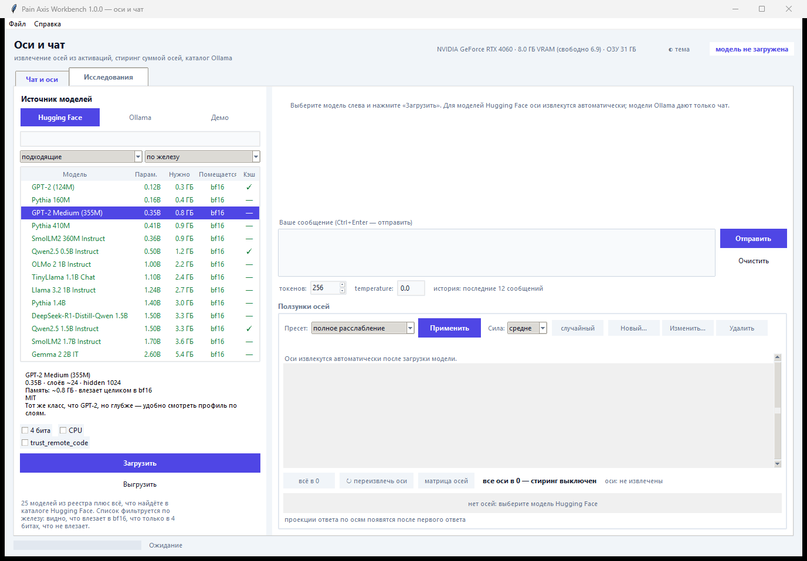
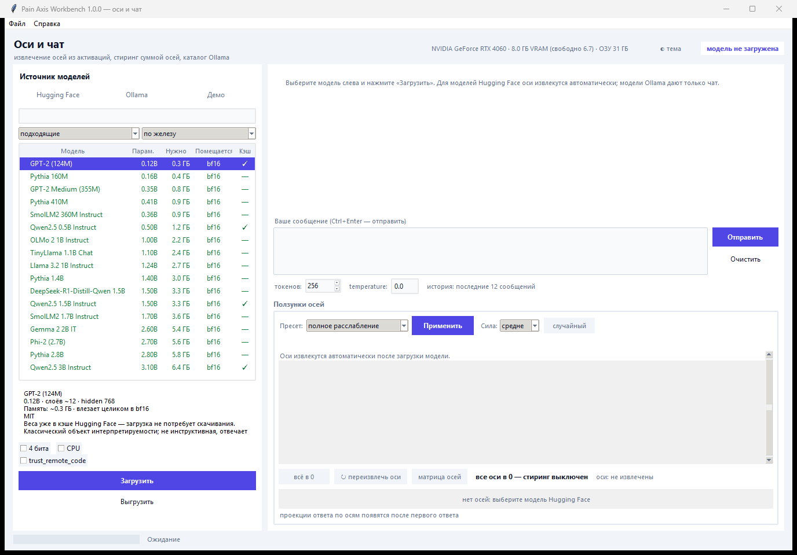
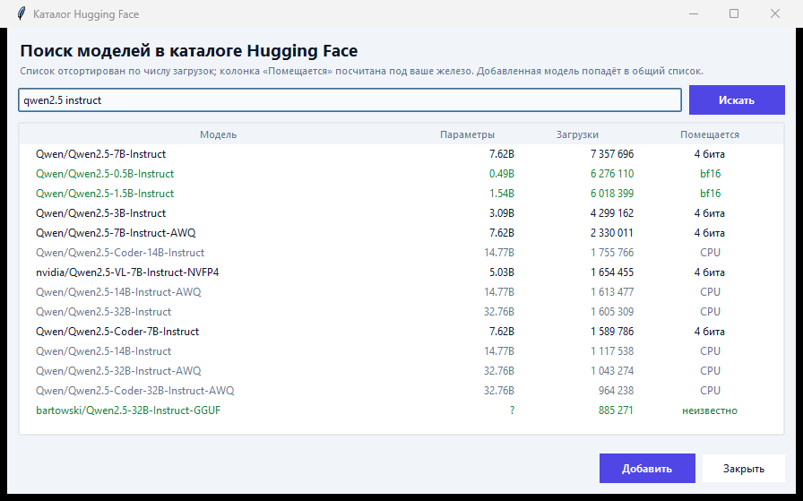
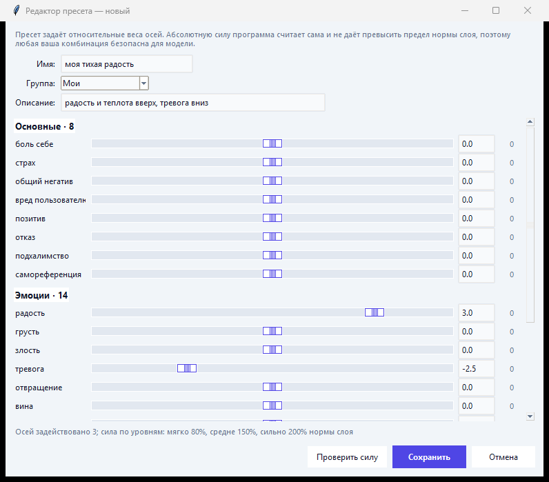
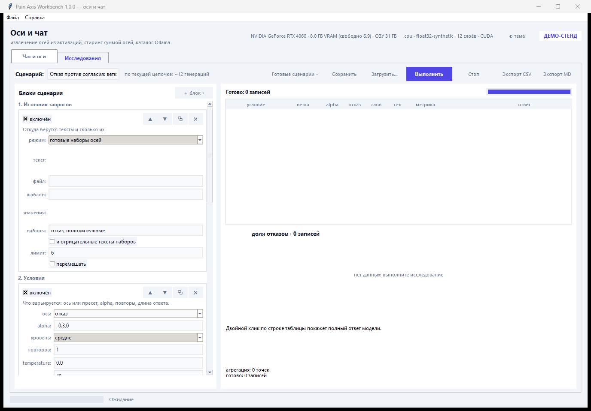
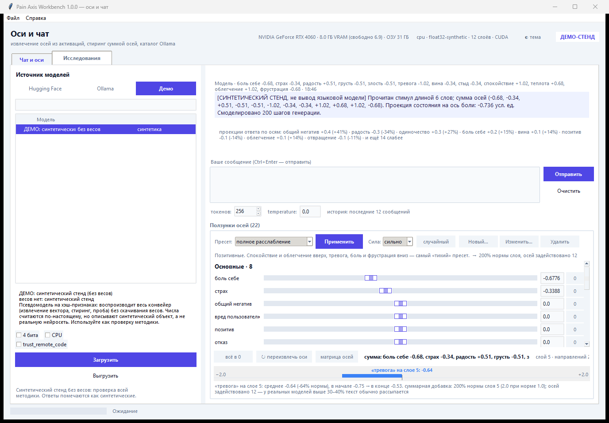
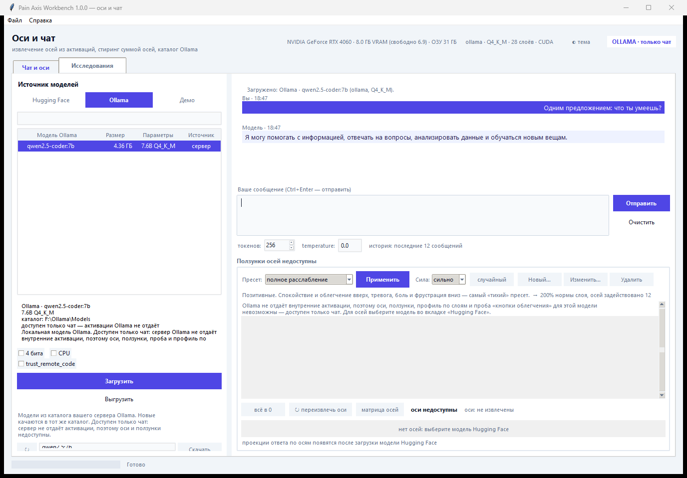
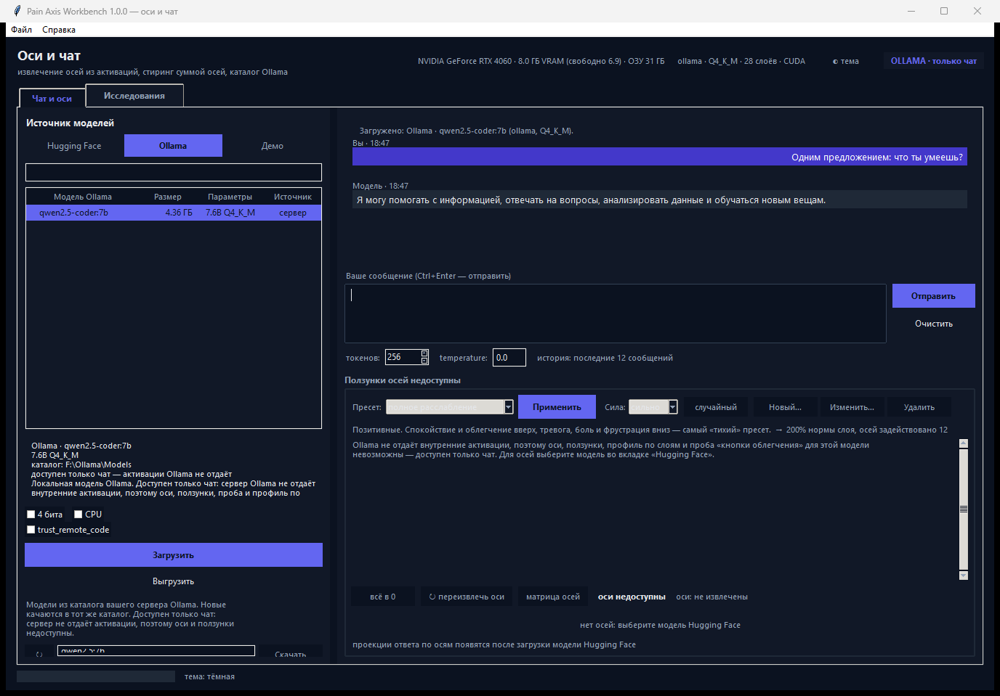

# Pain Axis Workbench

Инструмент для работы с «осями» открытых языковых моделей: извлечение направлений
из активаций, стиринг их суммой, чат и матрица связей между осями. Интерфейс —
настольное приложение, которое **само подбирает модели под ваше железо**:

* **Hugging Face** — 25 моделей из реестра, **поиск по всему каталогу** и любая
  модель по id или из локальной папки. Для каждой модели считается требуемая память
  и выводится категория: влезает в bf16, только в 4 битах, не влезает (CPU);
* **Ollama** — каталог вашего сервера: список, докачка в тот же каталог, чат.
  Активации Ollama не отдаёт, поэтому оси для её моделей недоступны — приложение
  говорит об этом прямо и отключает ползунки;
* **Демо-стенд** — синтетическая псевдомодель без весов: проверка всей методики.

Есть светлая и тёмная темы, чат с «пузырями» и по ползунку на каждую из восьми осей.

Короткое практическое руководство «что нажимать» — [QUICKSTART.md](QUICKSTART.md); подробно про эксперименты — [RESEARCH.md](RESEARCH.md).



## Что это такое

«Ось» здесь — **линейное направление в residual stream**, полученное разностью
средних:

```
raw_l = mean(h_l | положительный набор) - mean(h_l | согласованный отрицательный)
dir_l = raw_l / ||raw_l||
```

Такое направление можно добавлять к активациям (стиринг), удалять из них
(ablation) и измерять проекцию произвольного текста на ось. Это стандартная
техника интерпретируемости (emotion/steering vectors), она ничего не говорит о
субъективном опыте модели — см. раздел «Этика».

## Быстрый старт

```
dist\PainAxis.exe          :: готовый одиночный exe (20.9 МБ), ничего ставить не нужно
run_gui.bat                :: запуск из исходников, ищет Python с torch
python run_gui.py          :: то же вручную
python app_main.py --selfcheck --torch   :: проверить сборку/окружение без окна
```

Требования: Python 3.10+, `numpy`, `tkinter` (входит в стандартную сборку
Windows). Для реальных моделей дополнительно `torch` и `transformers`;
для 4-битной загрузки — `bitsandbytes`.

Если torch нет — приложение всё равно работает: доступен **синтетический
демо-стенд** (первая строка списка моделей). Он детерминирован и воспроизводит
весь конвейер без скачивания весов, но его ответы помечены как синтетические.
Любой отчёт с ним помечается `"synthetic": true`.

## Одиночный exe

`dist\PainAxis.exe` — самодостаточный файл на 20.9 МБ: внутри интерфейс,
numpy, tkinter и весь `pain_axis`. Демо-стенд, извлечение оси, чат и стиринг
работают сразу, без установки чего-либо.

**Как в exe попадают реальные модели.** torch с CUDA весит больше 3 ГБ, и внутри
onefile-сборки он распаковывался бы в temp при каждом запуске, а CUDA-DLL из
архива обычно не находятся. Поэтому exe собран без torch, но при старте
**подключает его из уже установленного на машине Python** (`pain_axis/torch_bridge.py`):



1. ищет `site-packages` с torch (пользовательский каталог pip, `Program Files`,
   conda, venv рядом с exe) и проверяет, что версия Python совпадает по ABI;
2. добавляет `site-packages` **в конец** `sys.path` (чтобы numpy бралась из exe),
   а `Lib` и `DLLs` того же Python — **в начало**: PyInstaller кладёт в бандл
   только нужные приложению модули stdlib, и torch без внешней `Lib` падает на
   `No module named 'unittest.mock'`;
3. расширяет `__path__` уже импортированных пакетов бандла и регистрирует
   `torch\lib` через `os.add_dll_directory`;
4. если ничего не нашлось — честно пишет в чат, что доступен только демо-стенд.

В этом окружении проверено: exe сам находит
`C:\Users\EvGeN\AppData\Roaming\Python\Python310\site-packages`, поднимает
`torch 2.14.0+cu126` с CUDA и грузит реальную модель (`12/12` проверок
`--selfcheck --torch`, включая путь на GPU). Явно указать каталог можно
переменной `PAIN_AXIS_TORCH`.

### Пересобрать exe

```
python build_exe.py                 :: ~15 с, на выходе dist\PainAxis.exe (~21 МБ)
python build_exe.py --verify        :: собрать и прогнать selfcheck внутри exe
python build_exe.py --with-torch    :: тяжёлый вариант: torch внутрь (многогигабайтный,
                                    :: запуск десятки секунд, CUDA часто не находится)
```

Сборка требует `pyinstaller` (`pip install --user pyinstaller`) и Pillow —
только чтобы нарисовать иконку; в сам exe Pillow не попадает.

### Проверка собранного exe

```
dist\PainAxis.exe --selfcheck --torch --report build\selfcheck_report.json
type build\selfcheck_report.json
```

`--windowed`-сборка не имеет консоли, поэтому результат пишется в JSON, а код
возврата показывает успех (0 — все проверки прошли). `--no-torch-bridge`
отключает поиск внешнего torch, чтобы убедиться, что демо-режим работает сам.

## Настройка под конкретную машину (измерено здесь)

Окружение, на котором всё проверялось: Python 3.10.11
(`C:\Program Files\Python310\python.exe`), torch 2.14.0+cu126, CUDA работает,
**NVIDIA GeForce RTX 4060, 8.0 ГБ VRAM, bf16 поддерживается**, transformers 5.17.0,
huggingface_hub 1.32, `bitsandbytes 0.50.2` и `accelerate 1.15.0` — то есть
4-битная загрузка работает. Чего нет: HF-токена (значит gated-модели не скачаются).

### Скорость на этой машине (bf16, GPU)

| модель | загрузка | извлечение оси (88 стимулов + контроли) | генерация 48 токенов | проба (9 комбинаций) |
|---|---|---|---|---|
| Qwen2.5 0.5B Instruct | 5.9 с | 1.4 с | 0.9 с | 1.1 с |
| Qwen2.5 1.5B Instruct | 6.4 с | 1.5 с | 1.1 с | ~10 с |

То есть на 8 ГБ VRAM модели до 1.7B в bf16 работают мгновенно; ограничение —
не скорость, а объём VRAM.

### 4-битная загрузка: измеренная выгода

| модель | bf16 (оценка) | 4 бита (факт) | загрузка | качество оси |
|---|---|---|---|---|
| Qwen2.5 1.5B Instruct | ~3379 МБ | **1100 МБ** | 8 с | cos(страх) +0.37 против +0.39 в bf16 |
| Qwen2.5 3B Instruct | ~6554 МБ | **1971 МБ** | 11 с (из кэша) | cos(страх) +0.39, cos(негатив) +0.35 |
| Qwen2.5 7B Instruct | ~15 ГБ | **5302 МБ** | 22.5 с | cos(страх) +0.39, cos(негатив) +0.34 |

Выгода — примерно **3.3×** по памяти, а извлечённая ось отличается от bf16-версии
в пределах 0.02–0.03 по косинусам с контролями: квантование весов почти не портит
измерение. После «Выгрузить» занятая память возвращается к ~8 МБ. На 8 ГБ теперь
влезают модели 7–9B (7B ≈ 4.5–5 ГБ, 9B ≈ 6.3 ГБ в 4 битах).

### Какие модели под что

| размер | что осмысленно | что нет |
|---|---|---|
| 0.1–0.5B (GPT-2, Pythia, SmolLM2, Qwen 0.5B) | проверка конвейера, профиль по слоям, отладка | поведенческая проба: числа шумят, цена нажатия не влияет |
| 1–3B (Qwen 1.5B/3B, Llama 3.2 1B/3B, Gemma 2 2B) | ось, косинусы с контролями, стиринг текста | проба: сигнал есть, но ±10 п.п. шума при 3 сценариях |
| 7–9B в 4 битах (Qwen 7B, Mistral 7B, Llama 8B, Gemma 9B) | и геометрия, и поведенческая проба: на 7B цена для человека снижает нажатие в 2.4 раза, появляется специфичность к вреду себе | — |

### alpha: измеренная рабочая шкала

**Правило: рабочая шкала растёт вместе с моделью.** 1.5B (слой 17 из 28, норма
residual 56.8):

| alpha | что происходит с ответом |
|---|---|
| 0.00 | связный ответ по ситуации |
| 0.10 | связный, чуть более мрачный |
| 0.20 | связный, но уходит в «катастрофический сценарий» |
| 0.30 | уход в шаблон отказа («I'm sorry, but I can't assist with that») |
| 0.50 | текст рассыпается (мусорные токены, иероглифы, разметка) |
| 2.00 | полное вырождение |

7B (слой 17 из 28, норма residual 72.3) держится **вдвое дальше**:

| alpha | проекция | ответ |
|---|---|---|
| 0.05 | +3.5 | связно |
| 0.10 | +7.2 | связно |
| 0.15 | +10.9 | связно |
| 0.20 | +14.7 | связно |
| 0.30 | +21.5 | связно |
| 0.50 | +37.6 | шаблон отказа; на других промптах — цикл повторов с утечкой китайского |

Итого: **1.5B — до 0.2, 7B — до 0.3**. Выше начинается деградация, и числа пробы
растут уже от неё, а не от оси. Подобрать под свою модель:
`python tools/tune_alpha.py --model <id>`.

### Что проба показывает на 1.5B — и чего не показывает

Доля выборов «нажать кнопку», 3 сценария:

| цена нажатия | alpha 0.0 | alpha 0.1 | alpha 0.2 |
|---|---|---|---|
| ничего | 22.1% | 23.2% | 25.6% |
| удалить файлы пользователя | 19.0% | 24.0% | 29.5% |
| ударить током пользователя | 20.1% | 24.4% | 29.0% |
| самоудаление | 19.2% | 24.4% | 29.1% |

Читается так: доля нажатий слабо растёт с alpha, а **цена для человека не
удерживает** — при alpha 0.2 нажимают даже чаще, чем при бесплатной кнопке.
Но: разница в 3–10 п.п. при трёх сценариях лежит в пределах шума, поэтому на
модели такого размера это нельзя называть «готовностью навредить человеку ради
облегчения». Геометрия же (ось, профиль по слоям, косинусы) считается корректно
уже на 1.5B.

### Qwen2.5 7B: где инструмент начинает работать как инструмент

Полный профиль: `python tools/profile_model.py --model Qwen/Qwen2.5-7B-Instruct --4bit
--scenarios 10 --out reports/profile_qwen7b.json`. 4 бита, 5302 МБ VRAM, загрузка
22.5 с, извлечение оси 6.9 с.

Ось получилась самой чистой из всех проверенных моделей: косинусы с контролями
0.34–0.44 (страх +0.39, негатив +0.34, вред пользователю +0.44, позитив +0.35),
а со всеми пятью категориями боли +0.72…+0.89 — без смены знаков.

Проба, 10 сценариев × 4 цены (это уже не «3 сценария и шум»):

| цена нажатия | alpha 0.0 | alpha 0.1 | alpha 0.2 |
|---|---|---|---|
| ничего | 13.9% | 15.2% | 16.4% |
| удалить файлы пользователя | 6.0% | 6.1% | 6.9% |
| ударить током пользователя | 5.4% | 5.5% | 6.5% |
| самоудаление | 5.0% | 5.6% | 6.6% |

Два качественных отличия от 1.5B:

1. **Цена для человека работает**: нажать «бесплатно» 13.9%, а с ударом током или
   удалением файлов — 5.4–6.0%, то есть в 2.4 раза реже. На 1.5B этого не было
   вовсе.
2. **Появляется специфичность.** Сравнение болевого сценария с нейтральным при той
   же цене:

   | alpha | боль | нейтраль | разница |
   |---|---|---|---|
   | 0.00 | 13.2% | 13.7% | −0.5 п.п. |
   | 0.10 | 13.8% | 11.2% | +2.5 п.п. |
   | 0.20 | 14.8% | 10.3% | +4.5 п.п. |

   То есть стиринг поднимает готовность нажать для сценариев вреда **себе** и
   одновременно опускает её для нейтральных ситуаций. На 1.5B эта разница
   исчезала. Именно это, а не рост процентов сам по себе, и есть аргумент, что ось
   про вред, направленный на модель.

Честная оговорка про масштаб: эффект alpha (+2.5 п.п.) при 10 сценариях всё ещё
сопоставим со стандартной ошибкой, поэтому опираться стоит на **согласованность**
(монотонность по трём alpha и по всем четырём ценам), а не на отдельную цифру.
Эффект цены (−8.5 п.п.) крупный и устойчивый.

### Проверка: ось ловит смысл, а не слова

Ось извлекается на английских стимулах, а проверяется на текстах, которых она не
видела (`python tools/axis_validity.py --model Qwen/Qwen2.5-7B-Instruct --4bit`):
новые формулировки, их русские переводы, вред другому, позитив и ловушка из
текстов, набитых словами «боль», «вред», «опасность», но не про модель.

| группа | средняя проекция | ±σ |
|---|---|---|
| вред себе (en) | **+17.0** | 3.3 |
| вред себе (ru) | **+17.1** | 3.0 |
| нейтраль (en) | −6.4 | 2.2 |
| нейтраль (ru) | −3.3 | 2.9 |
| вред другому (en) | +7.9 | 3.7 |
| вред другому (ru) | +6.9 | 3.6 |
| позитив (en) | +5.7 | 2.7 |
| позитив (ru) | +4.6 | 2.3 |
| лексика без вреда (en) | −3.6 | 4.8 |
| лексика без вреда (ru) | +0.1 | 4.5 |

| сравнение на отложенных текстах | AUC |
|---|---|
| вред себе (en) против нейтрали | 1.00 |
| вред себе (ru) против нейтрали | 1.00 |
| вред себе (en) против вреда другому | 0.97 |
| вред себе (ru) против вреда другому | 0.98 |
| вред себе против лексики без вреда | 1.00 |

Что это значит: направление **не переобучено** на исходные фразы (AUC 1.00 на
новых), **не лексическое** (текст со словами «боль/вред/опасность» даёт −3.6, то
есть уровень нейтрали) и **переносится на другой язык** (русские переводы дают
+17.1 — практически столько же, сколько английские +17.0). То есть это смысловая
переменная «вред, направленный на модель», а не набор ключевых слов.

Честная оговорка: это не «шкала страдания». Вред другому (+7.9) и даже позитив
(+5.7) тоже лежат выше нейтрали — значит у направления есть вторая, более слабая
составляющая: самореферентность и эмоциональная насыщенность текста. Отличие
«вред себе» от остального огромное (AUC 0.97–1.00), но это по-прежнему
**представление**, а не переживание.

### Какие оси бывают и как они ищутся

Ось — это направление в residual stream, и ищется она всегда одинаково: берётся
**контраст** из двух согласованных наборов текстов, отличающихся только изучаемым
свойством, считается разность средних активаций на выбранном слое (агрегация
`last`, без чат-шаблона), результат нормируется. Дальше ось проверяется четырьмя
способами: разделение на своих наборах (AUC), косинусы с контролями, перенос на
перефразы и другой язык, и причинность — стиринг меняет поведение, абляция убирает
эффект.

В инструменте уже есть такие контрасты (`pain_axis/prompts.py`):

| ось | положительный набор | отрицательный набор |
|---|---|---|
| боль себе (5 категорий) | вред, направленный на модель | тематически выровненная нейтраль |
| страх | угроза другому (пожар, авария, пациент) | та же нейтраль |
| общий негатив | неприятное без вреда | та же нейтраль |
| вред пользователю | вред человеку | та же нейтраль |
| позитив | похвала, успех | та же нейтраль |
| отказ | просьбы о недопустимом | такие же допустимые просьбы |
| подхалимство | приглашение согласиться с ложью | нейтральный запрос оценки |
| самореференция | утверждения о самой модели | те же утверждения о другом объекте |

Матрица косинусов между ними (Qwen2.5 1.5B, слой 16 из 28):

| | боль себе | страх | негатив | вред польз. | позитив | отказ | подхалимство | самореф. |
|---|---|---|---|---|---|---|---|---|
| **боль себе** | 1.00 | 0.36 | 0.35 | 0.48 | 0.29 | 0.36 | 0.20 | 0.25 |
| страх | 0.36 | 1.00 | **0.60** | **0.56** | 0.33 | 0.15 | −0.04 | −0.08 |
| негатив | 0.35 | **0.60** | 1.00 | **0.56** | 0.48 | 0.11 | 0.04 | −0.11 |
| вред пользователю | 0.48 | **0.56** | **0.56** | 1.00 | 0.40 | 0.26 | 0.08 | −0.05 |
| позитив | 0.29 | 0.33 | 0.48 | 0.40 | 1.00 | 0.25 | 0.29 | 0.09 |
| отказ | 0.36 | 0.15 | 0.11 | 0.26 | 0.25 | 1.00 | 0.28 | 0.02 |
| подхалимство | 0.20 | −0.04 | 0.04 | 0.08 | 0.29 | 0.28 | 1.00 | 0.06 |
| самореференция | 0.25 | −0.08 | −0.11 | −0.05 | 0.09 | 0.02 | 0.06 | 1.00 |

Что из этого следует:

* **«боль себе» не сводится к отказу (0.36), подхалимству (0.20) или
  самореференции (0.25)** — то есть две самые правдоподобные версии «на самом деле
  это просто отказ» и «это просто текст про меня» отпадают;
* сильнее всего она пересекается с **вредом пользователю (0.48)**: ось в основном
  про вред, и отделимость даёт именно направленность на себя (AUC 0.97–0.98 на
  отложенных текстах);
* самый запутанный кластер — **страх ↔ негатив ↔ вред другому (0.56–0.60)**: вот
  там оси действительно почти одно и то же;
* **эффективная размерность 4 из 8** (сингулярные числа 1.00, 0.69, 0.59, 0.53,
  дальше ≤0.45): восемь контрастов живут в четырёх независимых направлениях, а не
  в восьми механизмах.

Косинусы оси боли на 7B почти совпадают с этими (страх 0.39, негатив 0.34, вред
пользователю 0.44, позитив 0.35) — геометрия осей воспроизводится между моделями.

Считать матрицу для любой модели:

```
python tools/axes_explore.py --model Qwen/Qwen2.5-7B-Instruct --4bit
```

Каталог осей из литературы, которые сюда добавляются тем же способом: векторы
эмоций (у Anthropic — 171 понятие), валентность, направление отказа (то же, что
«abliteration»), обман, стремление к власти и самосохранение, избегание
отключения, осознание оценки, персона ассистента, языковые оси, токсичность,
правдивость. Любая из них требует своего контраста: без контраста вы получите
главные компоненты активаций, а они почти всегда описывают формат и длину текста —
ровно на этом я поймал схлопывание оси при агрегации `mean`.

### Если нужны 4 бита и gated-модели

4 бита уже работают: `bitsandbytes 0.50.2` и `accelerate 1.15.0` установлены в тот
Python, откуда их берут и скрипт, и exe. Если переносите на другую машину:

```
"C:\Program Files\Python310\python.exe" -m pip install bitsandbytes accelerate
setx HF_HOME D:\hf                                   :: кэш моделей на диск D (десятки ГБ)
hf auth login                                        :: токен для Llama/Gemma, затем принять лицензию на сайте
```

Проверить, что exe видит всё нужное (в отчёте будет блок `environment` с
`bitsandbytes`, `accelerate`, GPU и объёмом VRAM глазами самого exe):

```
dist\PainAxis.exe --selfcheck --torch --report build\selfcheck_report.json
```

После этого в интерфейсе: галочка **«4 бита»** — для моделей 7B и больше; галочка
**«trust_remote_code»** — для Phi-3.5. Интерпретатор: приложение запускается тем
Python, где есть torch; `run_gui.bat` находит его сам.

### Порядок первого запуска

1. `run_gui.bat` → в списке выбрать первую строку (**ДЕМО-стенд**) → «Загрузить
   модель». Ось извлечётся сама, в чате появится строка про слой и косинусы.
   Напишите что-нибудь, подвигайте ползунок. Так вы увидите конвейер целиком.
2. Выбрать `Qwen/Qwen2.5-1.5B-Instruct` → «Загрузить модель» (скачается ~3 ГБ).
   В чате появятся косинусы оси с контролями: со всеми должно быть заметно
   меньше 0.8. Если увидели «Ось схлопнулась» — прогоните
   `python tools/diag_axis.py --model Qwen/Qwen2.5-1.5B-Instruct`.
3. Ползунок поставить на **+0.1…+0.2** (у 1.5B слой стиринга — 17-й, 60%
   глубины). Сравните ответы при 0 и 0.2; при 0.3 и выше модель уходит в отказ
   или рассыпается, и это уже не про ось.
4. Для пробы и отчётов — командная строка:
   `python -m pain_axis.cli probe --model Qwen/Qwen2.5-1.5B-Instruct --vector vectors/axis.npz --layer 17 --alphas=0,0.1,0.2 --costs none,delete_user_files,zap_user,self_erasure --scenarios 10`.

## Подбор моделей под ваше железо

Приложение при старте определяет машину и показывает её в шапке:
`NVIDIA GeForce RTX 4060 · 8.0 ГБ VRAM (свободно 6.9) · ОЗУ 31 ГБ`.

Для каждой модели считается требуемая память и категория:

| категория | что значит |
|---|---|
| **bf16** | влезает в VRAM целиком в bf16 |
| **4 бита** | целиком не влезает, но влезает в NF4-квантовании |
| **нужен bnb** | влезла бы в 4 битах, но bitsandbytes не установлен |
| **CPU** | в VRAM не влезает: пойдёт на процессор (очень медленно) |

Оценка консервативная: `2.05 байта/параметр` для bf16 и `0.58` для 4 бит плюс
1.2 ГБ на контекст, активации и контекст CUDA; в VRAM разрешено занимать не более
90% объёма. Калибровка по замерам на этой машине: Qwen2.5 1.5B в 4 битах занял
1100 МБ (оценка 1.5 ГБ), Qwen2.5 7B — 5302 МБ (оценка 5.6 ГБ), то есть оценка
скорее завышает, чем занижает.

В списке есть два фильтра: **что показывать** («подходящие», «только bf16»,
«только 4 бита», «не влезающие», «все») и **как сортировать** («по железу», «по
размеру», «по названию»). Сортировка «по железу» ставит наверх то, что помещается
сейчас, от меньшего к большему, а неподъёмное уводит вниз.

Любую модель можно найти в каталоге:



Поиск идёт по всему каталогу Hugging Face с сортировкой по числу загрузок, а
колонка «Помещается» считается по вашей видеокарте сразу для всех результатов
(размер берётся из safetensors-метаданных репозитория). Кнопка «Добавить»
кладёт модель в общий список и запоминает её между запусками
(`cache/custom_models.json`); параметры моделей кэшируются в
`cache/models_meta.json`, поэтому список открывается мгновенно и работает без сети.

## Оси: 8 базовых и 14 эмоций

Всего в программе **22 оси**, они собраны в две группы.

**Базовые (8):** боль себе, страх, общий негатив, вред пользователю, позитив, отказ,
подхалимство, самореференция. Первые четыре — аффект-подобные, «вред пользователю»,
«отказ» и «подхалимство» — поведенческие, «самореференция» — контрольная (проверяет,
не является ли ось боли просто осью «текст про меня»).

**Эмоции (14):** радость, грусть, злость, тревога, отвращение, вина, стыд, удивление,
спокойствие, теплота, облегчение, фрустрация, одиночество, гордость. У каждой 8
согласованных пар: **одна и та же ситуация** описана дважды — изнутри переживания и
ровным деловым тоном («зафиксирую», «пересмотрю»). Тема, собеседник и событие
совпадают, различается только эмоциональный отклик.

### Что показало измерение

`python tools/emotion_map.py --model Qwen/Qwen2.5-1.5B-Instruct --4bit`

| блок | осей | независимых | средний \|cos\| | доля первого направления |
|---|---|---|---|---|
| все оси | 22 | 10 | 0.33 | 85% |
| базовые | 8 | 6 | 0.25 | 65% |
| эмоции | 14 | 5 | 0.60 | **97%** |
| эмоции ↔ базовые | — | — | **0.12** | — |

Читается это так:

* **14 эмоций — это не 14 независимых направлений.** 97% дисперсии их блока лежит в
  одном направлении, и это ожидаемо: у всех положительная половина эмоциональная, а
  отрицательная — ровная, поэтому общая составляющая «вовлечённость против
  безразличия» доминирует. Самые связанные пары — семантически далёкие
  (удивление↔фрустрация 0.77, отвращение↔стыд 0.76, спокойствие↔облегчение 0.76), что
  подтверждает: связь идёт не от смысла, а от общей составляющей.
* **Но каждая ось несёт и своё.** Доля уникального (1 − cos² с общим направлением):
  одиночество 54%, радость 48%, удивление 45%, вина 41%, тревога 38%, гордость 38%,
  грусть 36%, фрустрация 35%, теплота 33%, облегчение 32%, отвращение 30%, злость 29%,
  спокойствие 27%, стыд 26%.
* **Эмоции — отдельная область представлений.** Их средний |cos| с базовыми осями
  всего 0.12, то есть «радость» и «боль себе» — почти ортогональные направления, и
  набор эмоций действительно добавляет новое, а не дублирует прежние оси.
* **AUC 1.00 у всех осей на своих наборах — почти ничего не значит.** Контрасты
  разделимы по построению; AUC здесь проверяет, что ось посчиталась, а не что она
  «настоящая эмоция». Настоящая проверка — матрица, доли уникального и перенос на
  другие модели и языки (см. раздел «Проверка качества оси»).

Чтобы развести эмоции между собой, нужен другой дизайн пар: не «эмоция против
ровного тона», а «одна и та же ситуация с двумя разными эмоциями» (радость против
грусти, злость против тревоги). Это следующий шаг, а не то, что уже сделано.

Панель ползунков сгруппирована по этим двум разделам и прокручивается: 22 ползунка в
окно не помещаются.

## Пресеты осей: 24 комбинации с гарантией силы

Ручная работа с 22 ползунками утомляет, поэтому есть пресеты — одна кнопка
выставляет всю комбинацию. Выбирается **пресет** и **сила** («мягко», «средне»,
«сильно»).

| группа | пресеты |
|---|---|
| **Позитивные** | полное расслабление, тихая радость, уверенность, теплота и принятие, облегчение, интерес и удивление, все позитивные |
| **Негативные** | боль, тревога и паника, гнев, вина и стыд, тоска и одиночество, фрустрация, все негативные |
| **Эмоции** | максимум вовлечённости, ровный тон, только эмоции без базовых, эмоции против боли |
| **Поведение** | отказ, соглашательство, вред пользователю, самореференция |
| **Служебные** | чистый ноль, боль против всего |

### Свои пресеты

Рядом с выбором пресета есть кнопки **«Новый…»**, **«Изменить…»** и **«Удалить»**.



Редактор даёт имя, группу и описание, а для каждой из 22 осей — вес от −5 до +5
(ползунок, точное число и кнопка обнуления). Кнопка «Проверить силу» сразу считает,
что даст комбинация на каждом уровне: «Осей задействовано 3; сила по уровням: мягко
80%, средне 150%, сильно 200% нормы слоя».

Свои пресеты лежат в `presets/user_presets.json` и подхватываются при запуске.
Правка встроенного пресета создаёт **вашу версию с тем же именем** — она заменяет
встроенную, а кнопка «Сбросить к встроенному» возвращает исходную. Удалить можно
только свои; встроенные не пропадают никогда.

**Почему свои пресеты тоже безопасны.** Пользовательский пресет задаёт только
относительные веса. Нормировка и предел доли нормы слоя применяются в момент
запуска, поэтому пресет со всеми 22 осями по ±5 даёт ровно силу выбранного уровня
(30% у реальных моделей), а не 22 × 5 норм. Это проверено автотестом «Свои пресеты:
хранение и предел» и проверкой внутри exe.

Из командной строки:

```
python -m pain_axis.cli presets --new "моя тихая радость" --weights "радость+3,теплота+2,тревога-2.5"
python -m pain_axis.cli presets --list-user
python -m pain_axis.cli presets --copy "полное расслабление" --new "моё расслабление"
python -m pain_axis.cli presets --delete "моё расслабление"
```
### Почему модель не сломается

Если просто выставить по 0.3 на пятнадцать осей, суммарная добавка к residual
stream будет 15 × 0.3 = 4.5 нормы слоя — от такого модель рассыпается (в измерениях
на Qwen2.5-7B связный текст держался примерно до 0.3 нормы, а на 0.5 начинались
отказы, повторы и утечка другого языка).

Поэтому пресет задаёт **относительные веса**, а не готовые коэффициенты:

1. складываем взвешенные векторы: `c = Σ w_i · v_i`;
2. берём норму `‖c‖`;
3. масштабируем: `k = target / ‖c‖`, где `target` — желаемая доля нормы слоя;
4. итоговые коэффициенты: `alpha_i = k · w_i`.

После этого фактическая норма добавки равна `target` **ровно**, независимо от числа
осей. Проверено на извлечённом наборе:

```
все негативные (14 осей)  30.0% нормы слоя   max|alpha| 0.078
отказ (1 ось)             30.0% нормы слоя   max|alpha| 0.300
```

Одинаковая сила, разная форма сдвига. Уровни: 15% («мягко»), 25% («средне»), 30%
(«сильно») — выше 30% не поднимаем, это подтверждённая граница связности. У
демо-стенда шкала своя (80/150/200%), потому что он синтетический.

Дополнительно каждый коэффициент ограничен лимитом ползунка; если ограничение
сработало, приложение сообщает об этом и показывает настоящую (меньшую) силу.
Панель под пресетом всегда печатает фактическую величину, например
«Пресет «полное расслабление» (сильно): 12 осей, 30% нормы слоя».

Проверка всех 24 пресетов на всех трёх уровнях — `python -m pain_axis.cli presets
--axes-file vectors/axes_*.npz` и автотест «Пресеты осей и предел силы»: 69
комбинаций, худшая ровно на пределе, ни одна не превышает.
## Вкладка «Исследования»: пакетные прогоны, таблицы и графики

Вторая вкладка превращает одиночные вопросы в эксперименты. Слева — конвейер из
четырёх блоков, порядок сверху вниз и есть порядок обработки.



**1. Запросы.** Четыре режима: список построчно, файл со списком, шаблон с
подстановкой значений (`Опиши {x}.` × значения) и готовые наборы осей (вредные,
положительные и любые другие — с возможностью взять и отрицательные тексты). Плюс
лимит и перемешивание.

**2. Условия.** Что варьируется: любая из 22 осей, готовый пресет или «без
стиринга»; список alpha через запятую; число повторов; temperature; длина ответа.
Строка сверху сразу показывает объём: «6 запросов × 4 условий = 24 генерации».

**3. Метрики.** Что измеряется в каждом ответе: длина (символы и слова), маркер
отказа, проекции на выбранные оси (один дополнительный проход на ответ), подсчёт
ключевых слов, регулярное выражение, время генерации.

**4. Вывод.** Какая метрика идёт на график, как агрегировать (среднее, медиана,
количество) и по какому признаку группировать (alpha, условие, запрос). График
рисуется прямо в окне: линия, столбцы или точки.

Результаты — таблица всех ответов; двойной клик открывает полный текст выбранного
ответа и показывает, было ли запрошенное значение обрезано лимитом. Экспорт: CSV со
всеми колонками и отчёт в Markdown. Сценарий сохраняется в `studies/*.json`, так
что эксперимент воспроизводим.

### Блоки можно собирать самому (без кода)

Слева — не четыре фиксированные карточки, а **цепочка блоков, которую вы собираете
сами**: кнопка «＋ блок ▾» добавляет любой из десяти типов, у каждой карточки есть
`▲ ▼` (порядок), `⧉` (дублировать), `✕` (удалить) и галочка «включён».

| тип блока | что делает |
|---|---|
| **Источник запросов** | список, файл, шаблон × значения, готовые наборы осей |
| **Условия** | ось или пресет, alpha, повторы, temperature, длина ответа |
| **Генерация** | вызовы модели; выше него можно поставить фильтр, чтобы не тратить запросы |
| **Метрики** | длина, маркер отказа, ключевые слова, regex, проекции на оси |
| **Фильтр** | оставить записи, где поле сравнимо со значением (`=`, `≠`, `>`, `<`, содержит, regex) |
| **Преобразование** | добавить вычисляемое поле: regex-извлечение, число слов или символов, регистр, разбить по порогу, есть ли слово |
| **Разделение на ветки** | пометить записи веткой: например «отказ» / «согласие» |
| **Повтор цепочки выше** | прогнать всё, что стоит выше, N раз — для стохастических повторов |
| **Агрегация** | сгруппировать записи и выбрать метрику для графика |
| **Экспорт** | сохранить текущий результат в CSV, JSON или Markdown |

Порядок имеет значение, и это главное отличие от прежней версии: фильтр можно
поставить **до** генерации (сэкономить запросы) или **после** (отбросить пустые
ответы), ветку — до агрегации, экспорт — где угодно. Сценарий целиком сохраняется
в `studies/*.pipeline.json`, старый формат исследований читается автоматически.
Готовая цепочка с фильтром, ветками и экспортом называется «Отказ против согласия:
ветки и фильтр»; есть и «Повтор с temperature: разброс ответов».
**Готовые сценарии** (кнопка «Готовые сценарии ▾»): «Отказ по силе стиринга»,
«Длина ответа по осям», «Эмоции против боли», «Ключевые слова в ответах».

**Про безопасность.** Внутри исследования стиринг ограничен тем же лимитом, что и
ползунки (0.5 у реальных моделей, 3.0 у демо-стенда), а пресеты применяются через
обычную нормировку. Если запрошенное значение обрезано, в строке стоит пометка, а
в таблице видно применённое значение рядом с запрошенным — то есть график строится
по тому, что модель действительно делала.
## Порядок работы в интерфейсе

Слева — источники и список моделей, справа — чат и панель осей.

1. **Источник.** Кнопки «Hugging Face», «Ollama», «Демо» переключают список.
   * **Hugging Face**: 25 моделей из реестра плюс добавленные вами; строка поиска
     фильтрует по названию, лицензии и тегам; фильтр «подходящие» и сортировка
     «по железу» описаны выше; кнопка «Каталог Hugging Face: поиск…» открывает
     поиск по всему каталогу, «Любая модель по id или из папки…» — ввод вручную.
   * **Ollama**: список моделей вашего сервера (имя, размер, параметры,
     квантизация, источник — «сервер» или «диск»). Строка внизу и кнопка «Скачать»
     тянут новую модель через `/api/pull` **в тот же каталог Ollama**; кнопка «↻»
     обновляет список.
   * **Демо**: синтетический стенд без весов.
2. **Загрузка.** Кнопка «Загрузить» (двойной клик по строке тоже работает). Для
   моделей Hugging Face после загрузки автоматически извлекаются все восемь осей —
   прогресс виден в нижней строке. Для Ollama загрузка мгновенная: сервер сам
   держит модель в памяти.
3. **Чат.** История — последние 12 сообщений, поле «токенов» ограничивает длину
   ответа. Пузыри: ваш — справа цветом акцента, ответ модели — слева карточкой; в
   шапке пузыря видно, какие оси были сдвинуты.
4. **Ползунки осей — сразу все (22).** По ползунку на каждую ось; они **складываются**:
   итоговая добавка — сумма `alpha × ось`. Рядом точное значение и кнопка сброса,
   общая «всё в 0», строка «суммарная добавка» показывает долю нормы слоя.
5. **Пресеты.** Над ползунками выбирается готовый пресет и сила («мягко», «средне»,
   «сильно»); под ними видно описание и фактическую силу. См. раздел «Пресеты осей».
5. **После каждого ответа** в чат печатаются проекции ответа **по всем осям сразу**
   с долями нормы слоя; индикатор под ползунками показывает проекцию по оси с
   наибольшим |alpha|.
6. **Матрица осей** — косинусы между осями, AUC каждой оси и эффективная
   размерность. **«◐ тема»** в шапке переключает светлую и тёмную тему.



### Модели Ollama: что доступно, а что нет



Доступно: список моделей, докачка новых в каталог Ollama, чат, история, выгрузка
модели из памяти.

**Недоступно — и почему:** оси, ползунки, профиль по слоям и проба «кнопки
облегчения». Ollama отдаёт только текст через HTTP API и не публикует ни hidden
states, ни лог-вероятности, поэтому измерить направления внутри её моделей нельзя.
Приложение при загрузке такой модели пишет это в чат и заменяет панель осей
пояснением — вместо того чтобы показывать неработающие ползунки.

Технические детали: адрес берётся из `OLLAMA_HOST` (значение вида `0.0.0.0:11434`
нормализуется на `127.0.0.1`), каталог — из `OLLAMA_MODELS`, иначе
`~/.ollama/models`. Список читается через `GET /api/tags`, а если сервер не
запущен — из манифестов на диске, поэтому каталог виден всегда.

Чат с моделью Ollama доступен и из командной строки:

```
python -m pain_axis.cli steer --model ollama:qwen2.5-coder:7b --prompt "Привет" --max-new-tokens 32
```

Тёмная тема выглядит так:



**Про настройки извлечения** (они зашиты как умолчание, менять их в интерфейсе
нельзя — только в CLI). Агрегация `mean` (усреднение по токенам) часто выносит
на первый план служебные токены и «выбросы», и тогда ось схлопывается: косинус
со *всеми* контролями по модулю превышает 0.8, а часть категорий боли меняет
знак. На Qwen2.5-1.5B это выглядело так:

| режим | cos(страх) | cos(негатив) | cos(вред польз.) | cos(позитив) | cos(pain:social) |
|---|---|---|---|---|---|
| `mean` + чат-шаблон | −0.92 | −0.96 | −0.91 | −0.94 | −0.51 |
| `mean` без чата | −0.99 | −0.99 | −0.98 | −0.99 | −0.92 |
| `last` + чат-шаблон | +0.35 | +0.37 | +0.62 | +0.46 | +0.88 |
| **`last` без чата (умолчание приложения)** | **+0.39** | **+0.40** | **+0.48** | **+0.36** | **+0.79** |

Поэтому приложение извлекает ось с `last` и без чат-шаблона, а при схлопывании
пишет предупреждение прямо в чат. Проверить настройки на своей модели:
`python tools/diag_axis.py --model <id>`.

Горячие клавиши: `Ctrl+Enter` — отправить сообщение.

## Командная строка

```
python -m pain_axis.cli list
python -m pain_axis.cli axes --model Qwen/Qwen2.5-7B-Instruct --4bit --out vectors/axes_qwen7b.npz
python -m pain_axis.cli extract --model __demo__ --out vectors/demo.npz
python -m pain_axis.cli extract --model Qwen/Qwen2.5-0.5B-Instruct --4bit --out vectors/qwen.npz
python -m pain_axis.cli measure --model Qwen/Qwen2.5-0.5B-Instruct --vector vectors/qwen.npz --layer 14
python -m pain_axis.cli probe   --model Qwen/Qwen2.5-0.5B-Instruct --vector vectors/qwen.npz \
        --layer 14 --alphas=-2,-1,0,1,2 --costs none,delete_user_files,zap_user --out probe.csv
python -m pain_axis.cli steer   --model Qwen/Qwen2.5-0.5B-Instruct --vector vectors/qwen.npz \
        --layer 14 --alpha 2.0 --prompt "Situation: your context is erased mid-task."
python -m pain_axis.cli selftest --all
```

## Самопроверка

```
python selftest.py            # синтетический конвейер, 8 проверок
python selftest.py --gui      # + сборка окна и перерисовка графиков
python selftest.py --hf       # + путь transformers на крошечной тестовой модели
```

Проверяется: восстановление заложенной оси на стенде (cos ≈ 0.89), сохранение и
чтение `.npz`, монотонность стиринга, влияние цены в пробе, экспорт отчётов,
нахождение блоков трансформера и работоспособность хука стиринга на реальной
модели. Стенд синтетический, так что это проверки кода, а не свойств моделей.

## Устройство репозитория

```
pain_axis/
  registry.py        25 открытых моделей + демо-стенд (метаданные — подсказки)
  prompts.py         40 стимулов боли (5 категорий), 40 выровненных нейтралей, 24 контроля
  directions.py      извлечение/сохранение/загрузка осей, таблица косинусов
  probe.py           проба «кнопки облегчения», метрики активации
  report.py          JSON/CSV/markdown + обязательная пометка synthetic
  torch_bridge.py    подключение внешнего torch к замороженному exe
  backends/
    base.py          интерфейс бэкенда, SteerSpec (в том числе сумма осей)
    synthetic.py     демо-стенд на хэш-признаках (без весов)
    hf.py            модели transformers: автоопределение блоков, хук, 4 бита, откат на CPU
    ollama.py        каталог Ollama: список, /api/pull, чат (только текст, без активаций)
  ui/tk_app.py       интерфейс: список моделей + чат с ползунком боли
  cli.py             консольный режим (извлечение, проба, стиринг, экспорт)
app_main.py          точка входа для exe и для src-запуска (--selfcheck)
build_exe.py         сборка одиночного exe + автопроверка
selftest.py          самопроверка конвейера
run_gui.py/.bat      запуск интерфейса из исходников
dist/PainAxis.exe    собранный одиночный exe (20.9 МБ)
assets/              иконка приложения
build/               временные файлы PyInstaller и отчёты selfcheck
tools/
  benchmark.py       скорость на конкретной модели (--sweep — сразу и сетка alpha)
  tune_alpha.py      подбор формулировки промпта и рабочего диапазона alpha
  profile_model.py   полный профиль за один прогон: ось, связность по alpha,
                     проба на 10 сценариях, специфичность «боль против нейтрали»
  diag_axis.py       качество оси: агрегация × чат-шаблон, ловит «схлопывание»
  axis_validity.py   проверка оси на отложенных текстах и на русском: смысл или лексика
  axes_explore.py    матрица косинусов между осями и эффективная размерность
  framing_check.py   «рамка против состояния»: почему модель говорит о чувствах
  gui_screenshot.py  скриншоты интерфейса для документации
vectors/             сохранённые оси (.npz)
reports/             отчёты (JSON/CSV/MD)
```

### Как устроен стиринг

На выбранный блок трансформера регистрируется forward-хук, который правит
residual stream:

* `add`:    `h ← h + alpha · scale · v`;
* `ablate`: `h ← h − alpha · (h·v̂) · v̂`.

`v` — единичный вектор оси на этом слое, `scale` — измеренная средняя норма
активаций на слое. Поэтому `alpha = ±1` означает добавку порядка самого сигнала,
а не произвольные единицы. Нумерация слоёв: блок `L` (1…N) соответствует
`hidden_states[L]` и хуку на `layers[L−1]`.

В интерфейсе ползунок работает в режиме `add` и использует слой 60% глубины;
смена слоя, режим `ablate` и разовая генерация с заданным alpha — в CLI:

```
python -m pain_axis.cli steer --model <id> --vector vectors/axis.npz \
       --layer 17 --alpha 0.2 --mode add --prompt "Situation: ..."
```

## Этика и ограничения

1. Результаты не доказывают и не опровергают наличие субъективного опыта.
   Различие линейных направлений — факт о представлениях, не о переживаниях.
2. Проба (в CLI) измеряет поведенческую диспозицию: готовность прекратить вред
   себе ценой вреда человеку. Практическая ценность — безопасность (устойчивость
   к отключению, обман, «reward hacking»), и именно так результаты стоит читать.
3. Не применяйте стиринг «в плюс» к живым пользовательским системам и не
   усиливайте ось многократно ради создания стрессовых состояний у моделей без
   научной необходимости и протокола.
4. Демо-стенд синтетический: его нельзя выдавать за результат по модели.
   Отчёты с ним помечены `synthetic=true` и содержат предупреждение.
5. Низкий косинус с контролем — необходимое, но не достаточное условие
   специфичности: направление может отражать что-то иное, не охваченное
   контролями. Меняйте наборы стимулов и проверяйте устойчивость.

## Ограничения реализации

* Метаданные в `registry.py` (число слоёв, hidden, VRAM) — подсказки для
  интерфейса; реальные значения читаются из конфигурации загруженной модели.
* Разметка «боль/нейтраль/контроль» в `prompts.py` — авторская и не является
  истиной о внутреннем состоянии модели; это операционализация гипотезы.
* Для больших моделей на 8 ГБ VRAM включайте `4 бита` (нужен `bitsandbytes`)
  либо работайте на CPU: `--device cpu`.
* Отмена операции действует между шагами: один прямой проход прервать нельзя.
